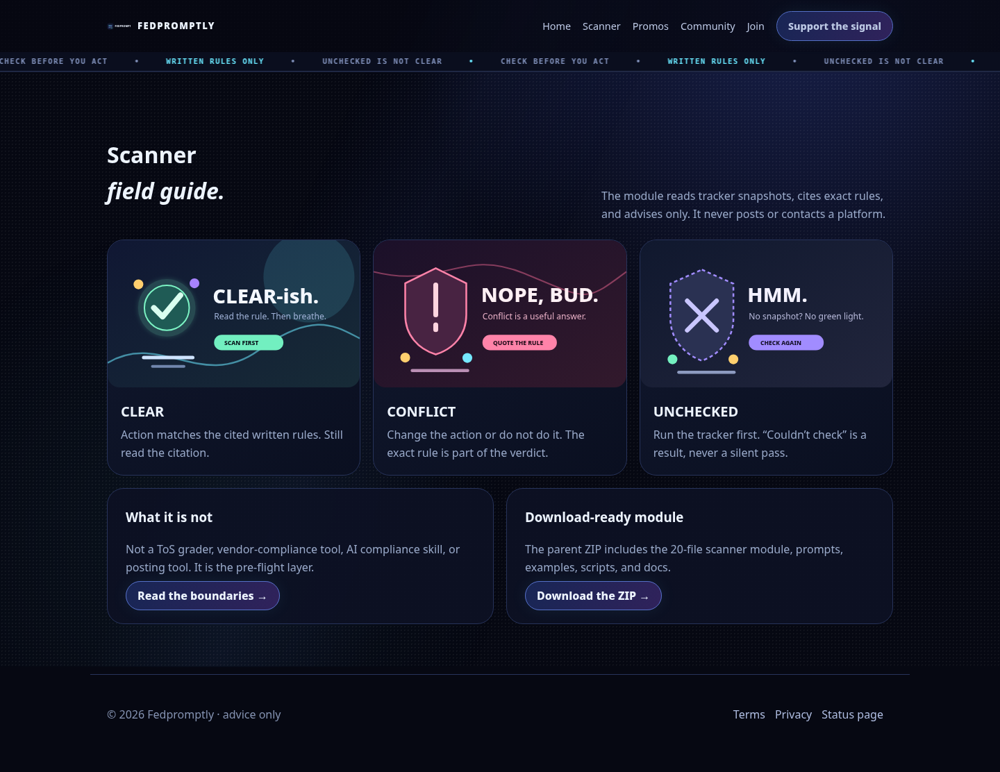
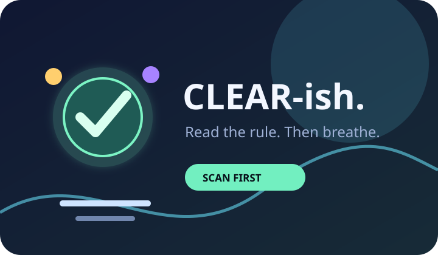
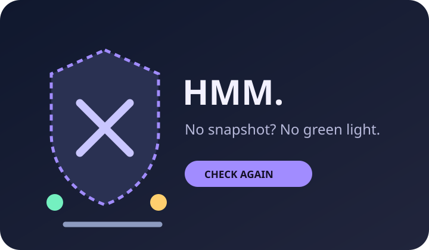

# Fedpromptly Terms of Service Scanner

**Check the written rules before you act — then keep the receipt.**

Fedpromptly is a local-first Terms of Service Scanner module plus a dark static landing site. It reads the Terms of Service Tracker’s saved snapshots, compares one user-named action against the written rules, and returns exactly one of four verdicts: **CLEAR**, **CONFLICT**, **CONTRADICTION**, or **UNCHECKED**.

> This repository is an advisory tool. It does not post, email, or contact platforms on your behalf.

[Open the local landing page](site/index.html) · [Read the scanner module](terms-of-service-tracker/scanner/README.md) · [See the setup guide](terms-of-service-tracker/scanner/docs/SCANNER-SETUP.md) · [View the scanner guide](site/scanner.html)


## Why this exists

Rules online are often scattered across pages, snapshots, moderator messages, and changing instructions. The frustrating part is not only finding a rule; it is knowing whether the action you are about to take matches the text that can actually be cited.

This is for people who want a pre-action check before posting, signing up, paying, or sharing something. The scanner intentionally treats written rules as the authority. A person saying “go ahead” does not silently override the rule. If the tracker has no usable snapshot, the answer is **UNCHECKED**, never a guessed pass.

## See it work

There is no hosted demo URL in this repository. The quickest real demo is the static landing page:

```bash
python3 -m http.server 8000 --directory site
```

Then open <http://127.0.0.1:8000/>. The site is plain HTML/CSS/JS and can be deployed by publishing `site/` to GitHub Pages or using it as the static output directory for Cloudflare Pages/Workers.




The visual pack is part of the working site, not a mock product board:







## Quick start

### Run the static site

```bash
python3 -m http.server 8000 --directory site
```

Open <http://127.0.0.1:8000/index.html>.

### Run a dry scanner check

The scanner uses only Python’s standard library. Create an action file from the template, then point the scanner at a tracker snapshot directory:

```bash
cp terms-of-service-tracker/scanner/templates/action-template.json /tmp/action.json
python3 terms-of-service-tracker/scanner/scripts/scan_action.py \
  /tmp/action.json \
  /path/to/terms-of-service-tracker/snapshots
```

If the platform has no snapshot, the correct result is `UNCHECKED` with the reason `no snapshot — run the tracker check first`.

Validate a saved verdict before showing it:

```bash
python3 terms-of-service-tracker/scanner/scripts/verdict_check.py \
  terms-of-service-tracker/scanner/checks/<verdict>.json
```

### Run the smoke test used for this package

```bash
python3 -m py_compile \
  terms-of-service-tracker/scanner/scripts/scan_action.py \
  terms-of-service-tracker/scanner/scripts/verdict_check.py
```

## Verdict model

| Verdict | Meaning | Next step |
|---|---|---|
| **CLEAR** | The action matches the cited written rules. | Read the citations, then decide whether to proceed. |
| **CONFLICT** | The action breaks a cited written rule. | Change the action or do not do it. |
| **CONTRADICTION** | A human instruction conflicts with the written rules. | Quote both; the written rule wins. |
| **UNCHECKED** | The rules could not be fetched or verified. | Run the tracker check first; never treat it as CLEAR. |

Every non-UNCHECKED result must cite exact rule text, source, and snapshot date. Every result is labeled `VERIFIED` or `UNVERIFIED`.

## Repository map

```text
terms-of-service-scanner-deliverable/
├── site/                                  # static HTML/CSS/JS landing site
│   ├── index.html                         # quickest visual entry point
│   ├── scanner.html                       # verdict guide
│   ├── promos.html                        # promotional image/GIF gallery
│   ├── support.html                       # age-gated payment/support page
│   ├── community.html                     # centered Discord widget
│   ├── discord.html                       # Discord buttons and protected 18+ flow
│   ├── join.html                          # optional Supabase email-list/auth page
│   └── assets/                            # favicon, symbol logo, banners, promos, GIF
└── terms-of-service-tracker/scanner/      # 20-file scanner module
    ├── scripts/                           # scan_action.py and verdict_check.py
    ├── prompts/                           # copy-paste operating prompts
    ├── templates/                         # action and verdict shapes
    ├── examples/                          # CLEAR, CONFLICT, CONTRADICTION, UNCHECKED
    └── docs/                              # setup, usage, and decisions
```

## Deployment notes

No GitHub Pages site, Cloudflare project, live URL, workflow, or package-manager build is included in this archive. The static site is deployment-ready by structure: publish `site/` as the Pages directory. Before production launch, review external provider configuration, Supabase redirect URLs, payment settings, age/financial compliance, and privacy requirements.

The favicon is a symbol SVG rather than a letter. Internal navigation uses HTML routes, including the download handoff, support confirmation, 404 page, and the optional join page.

## Design and safety boundaries

- The scanner reads tracker snapshots as its source of truth.
- User-named platforms and actions only; no guessing.
- No silent passes when rules are unavailable.
- No platform contact without a separate explicit order.
- Payment and adult-content flows are front-end gates, not legal or financial verification.
- The optional `join.html` page depends on the supplied Supabase project and CDN; it is not a bundled backend.

## License and status

No license file or package version is present in the supplied repository. This deliverable is a local specification/build package and has not been pushed to GitHub or published as a live site.
